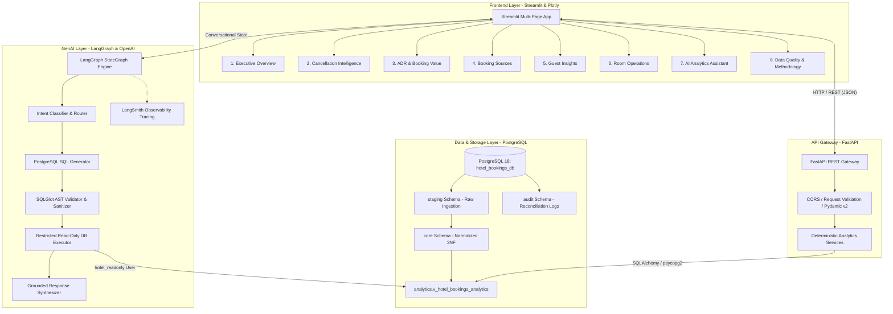

# StayWise AI — Hotel Booking Analytics & Intelligence Platform

[](https://www.python.org/)
[](https://www.postgresql.org/)
[](https://fastapi.tiangolo.com/)
[](https://streamlit.io/)
[](https://github.com/langchain-ai/langgraph)
[](https://github.com/tobymao/sqlglot)
[](https://docs.pytest.org/)

**StayWise AI** is an enterprise-grade, portfolio-ready hospitality analytics and conversational intelligence platform. It pairs high-performance PostgreSQL dimensional modeling and deterministic analytics services with an asynchronous FastAPI gateway, an interactive dark-themed Streamlit dashboard, and an audited LangGraph conversational AI assistant protected by SQLGlot AST validation.

The platform analyzes **119,390 hotel booking records** across **City Hotel** (79,330) and **Resort Hotel** (40,060) properties spanning July 2015 to August 2017.

---

## 1. System Architecture



---

## 2. Core Business Problems Solved

1. **Demand & Cancellation Trends**: Tracking monthly booking volume and cancellation rate trajectories across City and Resort properties.
2. **Property Comparison**: Contrasting corporate/short-stay City Hotels (41.73% cancellation rate) against leisure Resort Hotels (27.76% cancellation rate, longer lead times).
3. **Distribution Channel Performance**: Evaluating Direct (12.27% share, 17.46% cancel rate) vs TA/TO (81.97% share, 41.06% cancel rate).
4. **Deposit Policy Paradox**: Clarifying why Non-Refundable bookings exhibit a 99.36% cancellation rate (travel agencies releasing wholesale group tour blocks).
5. **Rate & Value Dynamics (ADR)**: Tracking seasonal pricing curves, isolating extreme outliers ($5,400.00 anomaly) via Median ADR ($94.58) vs Mean ADR ($101.83).
6. **Operational Room Allocation**: Monitoring why 12.49% of guests (14,917 stays) receive a different room type than reserved, with 73.9% executed by front-desk operations without guest edits.
7. **Conversational Intelligence**: Enabling stakeholders to query complex multi-table relationships conversationally with 100% verified SQL execution.

---

## 3. Data Integrity & Excel Corruption Resolution

During Phase 1 profiling, our team uncovered the root cause of duplicate keys in `Guest_info.csv`:
- **The Issue**: `Guest_info.csv` was previously edited in Microsoft Excel without text-import protections. Hexadecimal booking IDs containing `e` were auto-formatted as scientific notation floats (e.g., `125414e6` $\rightarrow$ `'1.25E+11'`), causing **598 mangled IDs** and **6 duplicate collision pairs (12 rows)**. Another **297 IDs** had leading zeros stripped.
- **The Impact**: A naive SQL join on `Booking_id` would trigger row multiplication (Cartesian explosion) and orphan 895 reservations.
- **The Deterministic Solution**: Physical row sequence (0 to 119,389) across all six source files was verified to be 100% identical. The ETL pipeline assigns a sequential `source_row_id` in staging, aligns with `Booking_details.csv`, restores all 895 canonical hex keys, and records every repair in `audit.etl_data_quality_reconciliation_log`.

---

## 4. Quickstart Guide (Windows CMD)

### 4.1 Prerequisites
- Python 3.10+ / 3.11+ / 3.12+ / 3.13+
- PostgreSQL 15+ / 16+ / 18+ running on `localhost:5432`

### 4.2 Clone & Environment Setup
Open **Windows Command Prompt (cmd.exe)**:

```cmd
cd C:\Users\pkatt\OneDrive\Desktop\Projects\Hotel_Bookings_Analytics

:: Copy environment variables template
copy .env.example .env

:: Install dependencies
pip install -r requirements.txt
```

Edit `.env` with your PostgreSQL password and OpenAI API key:
```env
POSTGRES_USER=postgres
POSTGRES_PASSWORD=YourPasswordHere
POSTGRES_DB=hotel_bookings_db
OPENAI_API_KEY=sk-proj-...
```

### 4.3 Database Initialization & Automated ETL
Initialize PostgreSQL schemas, tables, read-only security roles, and execute the automated ETL pipeline:

```cmd
:: Initialize database schemas and tables
python -m src.db.init_db

:: Run high-speed ETL pipeline (takes ~35 seconds for 119,390 rows)
python -m src.etl.pipeline
```

### 4.4 Run Automated Test Suite
Run the 20 automated unit, integration, and security tests:

```cmd
python -m pytest tests -v
```

All 20 tests verify row counts (119,390), reconciliation logs (895), SQL KPI formulas, API endpoints, SQLGlot AST security rules, and AI assistant query generation.

### 4.5 Launch Backend API (FastAPI)
```cmd
python -m uvicorn src.api.main:app --host 127.0.0.1 --port 8000 --reload
```
Interactive Swagger API documentation is available at:
`http://127.0.0.1:8000/docs`

### 4.6 Launch Interactive Dashboard (Streamlit)
In a separate command prompt:
```cmd
python -m streamlit run src/ui/app.py
```
The StayWise AI portal will open automatically at:
`http://localhost:8501`

---

## 5. Security & GenAI Guardrails

- **AST-Based Query Sanitization**: The LangGraph agent routes all generated SQL through `sqlglot`. It strictly rejects non-`SELECT` statements, comments, multi-statements, and system catalogs, and enforces a mandatory `LIMIT 500`.
- **Database Role Isolation**: AI queries run exclusively against the `hotel_readonly` PostgreSQL role, which has zero `INSERT`/`UPDATE`/`DELETE`/`DDL` privileges and a 5,000 ms statement timeout.
- **Estimated Booking Value vs Realized Revenue**: The platform strictly enforces that `adr * total_nights` is an **Estimated Booking Value**, never financial ledger revenue. Realized booking value is only attributed to fulfilled stays (`is_canceled = 0`).

---

## 6. Repository Layout

```text
Hotel_Bookings_Analytics/
├── .env.example
├── .gitignore
├── README.md
├── requirements.txt
│
├── config/
│   ├── settings.py              # Pydantic BaseSettings for configurations
│   └── logging_config.py        # Structured logging
│
├── docs/                        # Complete Phase 1 & Architecture Deliverables
│   ├── 01_DATASET_INVENTORY.md
│   ├── 02_DATA_DICTIONARY.md
│   ├── 03_DATA_QUALITY_REPORT.md
│   ├── 04_BOOKING_ID_INTEGRITY_REPORT.md
│   ├── 05_ENTITY_RELATIONSHIP_DIAGRAM.md
│   ├── 06_BUSINESS_PROBLEM_STATEMENT.md
│   ├── 07_KPI_METHODOLOGY_AND_LIMITATIONS.md
│   ├── 08_POSTGRESQL_SCHEMA_DESIGN.md
│   ├── 09_APPLICATION_ARCHITECTURE.md
│   ├── 10_PHASED_IMPLEMENTATION_PLAN.md
│   ├── 11_RISKS_AND_UNRESOLVED_QUESTIONS.md
│   └── README.md
│
├── src/
│   ├── db/                      # Database init & session management
│   ├── etl/                     # Automated ETL & reconciliation pipeline
│   ├── services/                # Deterministic SQL analytics engines
│   ├── api/                     # FastAPI backend gateway & routers
│   ├── ai/                      # LangGraph + SQLGlot AI analytics assistant
│   └── ui/                      # Streamlit dashboard & Plotly components
│
└── tests/                       # 20 Automated Unit, Integration & Security Tests
    ├── test_etl.py
    ├── test_analytics_sql.py
    ├── test_api.py
    ├── test_sql_guard.py
    └── test_ai_agent.py
```

---

## 7. License & Attribution

Developed for demonstration as an enterprise Data Engineering, Analytics Engineering, and GenAI Portfolio project. Built with Python, PostgreSQL, FastAPI, Streamlit, Plotly, OpenAI, LangGraph, and SQLGlot.
