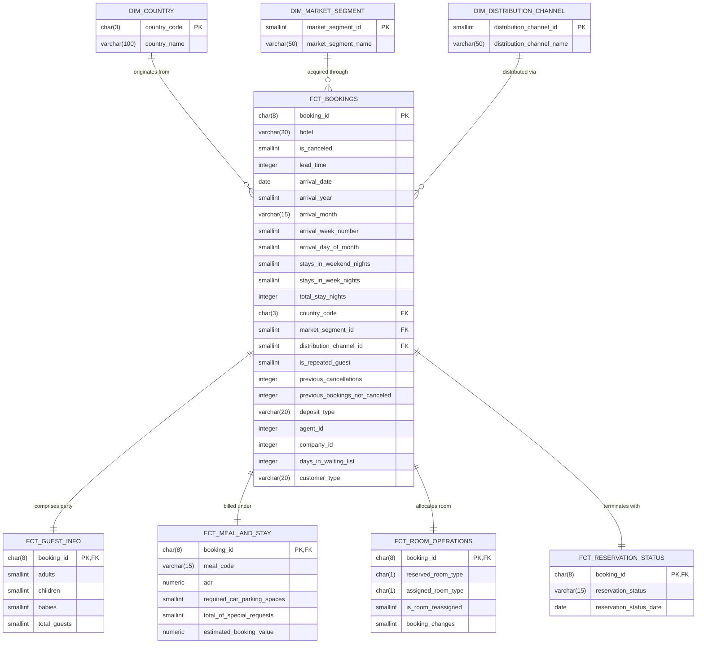

# StayWise AI — Entity Relationship Diagram (ERD)

## 1. Relational Core Architecture (Cleaned 3NF Model)

The diagram below illustrates the normalized relational structure designed for PostgreSQL (`hotel_bookings_db`), connecting the core booking reservation entity to its operational child tables and validated dimension lookup tables.

---

## 2. Curated Dimensional / Analytical View (`v_hotel_bookings_analytics`)

For high-performance BI reporting, Streamlit visualization, and LLM text-to-SQL generation, all normalized entities are projected into a single, fully typed, denormalized view:

```mermaid
flowchart TD
    subgraph Dimension_Tables [Lookup Dimensions]
        DC[dim_country]
        DMS[dim_market_segment]
        DDC[dim_distribution_channel]
    end

    subgraph Relational_Entities [Transactional Facts]
        FB[fct_bookings]
        FGI[fct_guest_info]
        FMS[fct_meal_and_stay]
        FRO[fct_room_operations]
        FRS[fct_reservation_status]
    end

    subgraph Analytical_View [v_hotel_bookings_analytics]
        direction TB
        V1["booking_id PK"]
        V2["hotel, is_canceled, lead_time, arrival_date"]
        V3["stays_weekend, stays_week, total_stay_nights"]
        V4["country_code, country_name"]
        V5["market_segment, distribution_channel"]
        V6["adults, children, babies, total_guests"]
        V7["meal, adr, estimated_booking_value"]
        V8["reserved_room, assigned_room, is_room_reassigned"]
        V9["deposit_type, customer_type, is_repeated_guest"]
        V10["special_requests, parking_spaces, booking_changes"]
        V11["reservation_status, reservation_status_date"]
    end

    DC --> V4
    DMS --> V5
    DDC --> V5
    FB --> V1
    FGI --> V6
    FMS --> V7
    FRO --> V8
    FRS --> V11

    V1 --> Streamlit["Streamlit Dashboard"]
    V1 --> FastAPI["FastAPI Backend Services"]
    V1 --> AI_Agent["LangGraph AI SQL Assistant"]
```

