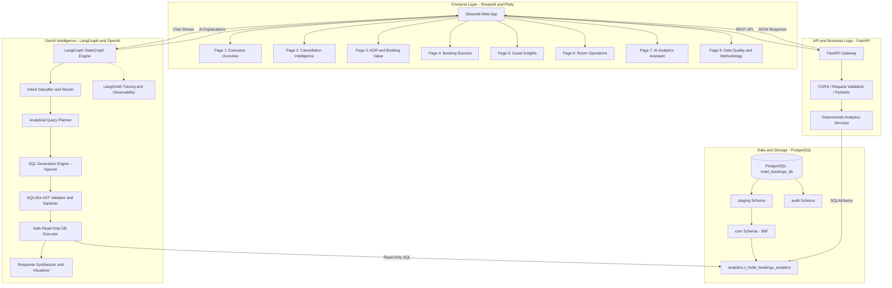

# StayWise AI — Application Architecture & Directory Structure

## 1. System Architecture Overview

StayWise AI is engineered as a decoupled, multi-tier analytics and GenAI intelligence platform. It combines a robust SQL analytical engine with an asynchronous REST backend, an interactive Streamlit visualization portal, and an audited LangGraph conversational AI agent guarded by SQLGlot AST validation.



---

## 2. Layer Specifications

### 2.1 Data Layer
- **PostgreSQL 15+ / 16+**: Hosts `hotel_bookings_db`.
- **SQLAlchemy 2.0+ & psycopg3**: Enterprise connection pooling, typed models, and execution lifecycle management.
- **Role-Based Access**:
  - `staywise_etl_user`: Read/write access to `staging`, `core`, `analytics`, `audit`.
  - `staywise_app_user`: Read-only access to `analytics.v_hotel_bookings_analytics` and core tables for backend services.
  - `staywise_ai_readonly`: Strictly restricted `SELECT`-only account with statement timeouts (5000ms) and table white-listing for the LangGraph execution tool.

### 2.2 Backend Layer (FastAPI)
- **FastAPI**: Asynchronous REST framework providing modular routers (`/overview`, `/cancellations`, `/revenue`, `/channels`, `/guests`, `/rooms`, `/trends`, `/analyze`).
- **Pydantic v2**: Strict schema validation for request parameters, query filters (date ranges, hotel types, channels), and typed JSON responses.
- **Analytics Services**: Reusable, pure-Python and SQL calculation modules decouples database access from HTTP route handlers.

### 2.3 AI Layer (LangGraph + SQLGlot + LangSmith)
- **LangGraph Multi-Step StateGraph**:
  1. *Classify Analytical Intent*: Determine whether the query matches a standard KPI tool or requires custom analytical SQL.
  2. *Schema & Metric Grounding*: Inject vetted schema documentation and KPI definitions into prompt context.
  3. *SQL Generation*: Synthesize PostgreSQL-compliant SQL using OpenAI GPT-4o / GPT-4o-mini.
  4. *AST Security Audit (SQLGlot)*:
     - Parse AST to verify the statement is strictly a single `SELECT`.
     - Reject `INSERT`, `UPDATE`, `DELETE`, `DROP`, `ALTER`, `TRUNCATE`, `CREATE`, `GRANT`, `COPY`, or comment-based injections.
     - Reject access to system catalogs (`pg_catalog`, `information_schema`) or raw `staging` tables.
     - Enforce a mandatory `LIMIT 500`.
  5. *Execution & Grounded Synthesis*: Execute on the isolated read-only connection, format tabular data, generate Plotly chart specifications, and explain business findings without hallucinations.
- **LangSmith**: Full distributed tracing of token usage, latency, tool calls, and query execution.

### 2.4 Frontend Layer (Streamlit & Plotly)
- **Streamlit**: Multi-page dashboard with dark theme typography, KPI metrics cards, responsive sidebar filters, and CSV data export capabilities.
- **Plotly**: Rich, interactive visualizations (seasonal heatmaps, stacked bar charts, waterfall charts, scatter distributions).
- **Conversational Assistant Page**: Chat interface with conversation threads, suggested prompts, SQL transparency toggles, and direct chart rendering.

---

## 3. Recommended Project Directory Structure

```text
Hotel_Bookings_Analytics/
├── .env.example
├── .gitignore
├── README.md
├── requirements.txt
├── pyproject.toml
│
├── config/
│   ├── __init__.py
│   ├── settings.py              # Pydantic BaseSettings for DB, OpenAI, App configs
│   └── logging_config.py        # Structured JSON logging
│
├── data/                        # Local data exports / test fixtures (Git-ignored)
│
├── docs/                        # Complete Phase 1 & Architecture documentation
│   ├── 01_DATASET_INVENTORY.md
│   ├── 02_DATA_DICTIONARY.md
│   ├── 03_DATA_QUALITY_REPORT.md
│   ├── 04_BOOKING_ID_INTEGRITY_REPORT.md
│   ├── 05_ENTITY_RELATIONSHIP_DIAGRAM.md
│   ├── 06_BUSINESS_PROBLEM_STATEMENT.md
│   ├── 07_KPI_METHODOLOGY_AND_LIMITATIONS.md
│   ├── 08_POSTGRESQL_SCHEMA_DESIGN.md
│   ├── 09_APPLICATION_ARCHITECTURE.md
│   ├── 10_PHASED_IMPLEMENTATION_PLAN.md
│   └── 11_RISKS_AND_UNRESOLVED_QUESTIONS.md
│
├── src/
│   ├── __init__.py
│   │
│   ├── db/                      # Database connection and DDL
│   │   ├── __init__.py
│   │   ├── session.py           # SQLAlchemy engines & connection pools
│   │   ├── models.py            # Declarative SQLAlchemy ORM models
│   │   └── migrations/          # DDL scripts for staging, core, and views
│   │
│   ├── etl/                     # Ingestion and data cleaning pipeline
│   │   ├── __init__.py
│   │   ├── extractor.py         # CSV loader with row-ID tracking
│   │   ├── transformer.py       # Excel corruption repair & type cast logic
│   │   ├── loader.py            # PostgreSQL COPY and upsert execution
│   │   └── pipeline.py          # Orchestrated idempotent ETL runner
│   │
│   ├── services/                # Reusable deterministic SQL analytics
│   │   ├── __init__.py
│   │   ├── overview_service.py
│   │   ├── cancellation_service.py
│   │   ├── revenue_service.py
│   │   ├── channel_service.py
│   │   ├── guest_service.py
│   │   └── room_service.py
│   │
│   ├── api/                     # FastAPI backend
│   │   ├── __init__.py
│   │   ├── main.py              # FastAPI app instance and middleware
│   │   ├── schemas.py           # Pydantic v2 schemas
│   │   └── routers/             # Modular endpoints
│   │       ├── health.py
│   │       ├── overview.py
│   │       ├── cancellations.py
│   │       ├── revenue.py
│   │       ├── channels.py
│   │       ├── guests.py
│   │       ├── rooms.py
│   │       └── chat.py
│   │
│   ├── ai/                      # GenAI LangGraph Assistant
│   │   ├── __init__.py
│   │   ├── graph.py             # LangGraph StateGraph definitions
│   │   ├── state.py             # Typed AgentState
│   │   ├── prompts.py           # System prompts and schema contexts
│   │   ├── sql_guard.py         # SQLGlot AST validation & sanitization
│   │   ├── tools.py             # Deterministic tools & DB executor
│   │   └── tracer.py            # LangSmith observability setup
│   │
│   └── ui/                      # Streamlit dashboard
│       ├── app.py               # Main entry point & navigation
│       ├── components/          # Reusable UI widgets & KPI cards
│       ├── utils.py             # API client and formatting utilities
│       └── pages/               # 8 individual multi-page views
│           ├── 1_Executive_Overview.py
│           ├── 2_Cancellation_Intelligence.py
│           ├── 3_ADR_and_Booking_Value.py
│           ├── 4_Booking_Sources.py
│           ├── 5_Guest_Insights.py
│           ├── 6_Room_Operations.py
│           ├── 7_AI_Analytics_Assistant.py
│           └── 8_Data_Quality_and_Methodology.py
│
└── tests/                       # Comprehensive test suite
    ├── __init__.py
    ├── conftest.py
    ├── test_etl.py              # Ingestion & deduplication tests
    ├── test_analytics_sql.py    # Metric reconciliation tests
    ├── test_api.py              # FastAPI endpoint tests
    ├── test_sql_guard.py        # SQLGlot security AST tests
    └── test_ai_agent.py         # LangGraph evaluation tests
```
