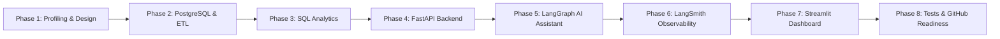

# StayWise AI — Phased Implementation Plan

## 1. Roadmap & Milestone Overview

This plan details the sequential progression of StayWise AI from Phase 1 through Phase 8, outlining the specific objectives, technical gates, and verification criteria for each phase.

---

## 2. Phase-by-Phase Execution Details

### Phase 1 — Dataset Profiling, Architecture & Planning (CURRENT)
- **Status**: Completed.
- **Objectives**: Inspect all 23 files, analyze SHA-256 hashes, diagnose Excel booking identifier corruption, evaluate semantic anomalies (ADR, dates, zero stays), design 3NF schema and analytical view, establish KPI methodologies, and author architectural blueprints.
- **Deliverables**: 11 markdown specifications under `docs/`.
- **Exit Gate**: User review and explicit approval before starting Phase 2.

### Phase 2 — PostgreSQL Database & Robust ETL Pipeline
- **Objectives**:
  - Provision `hotel_bookings_db` with `staging`, `core`, `analytics`, and `audit` schemas.
  - Implement configurable database connections via `psycopg3` and SQLAlchemy.
  - Build idempotent Python ETL pipeline:
    - Load source CSVs into `staging.stg_*` via PostgreSQL `COPY`.
    - Apply deterministic Excel corruption repair using `source_row_id` alignment to restore all 895 corrupted `Booking_id` values.
    - Trim whitespace from lookup tables (`dim_country`).
    - Impute missing values (`children = 0`, `country = 'NULL'`).
    - Load normalized entities into `core.fct_*` and `core.dim_*`.
    - Create `analytics.v_hotel_bookings_analytics`.
    - Log run results and row reconciliation audits.
- **Exit Gate**: Reconciliation test verifying exactly 119,390 rows loaded into `fct_bookings` with 0 duplicate keys and 0 orphaned foreign keys.

### Phase 3 — Deterministic SQL Analytics Services
- **Objectives**:
  - Implement pure Python/SQL analytics service modules covering all 6 domain areas:
    1. Executive Overview & Seasonal Demand
    2. Cancellation Intelligence (Lead time bands, deposit types, customer segments)
    3. Revenue & ADR Dynamics (ADR distributions, estimated booking value, seasonal pricing)
    4. Distribution Channel Intelligence (Direct vs TA/TO, channel cancellation risk)
    5. Guest Demographics & Hospitality Services (Party composition, meal plans, car parking)
    6. Room Operations (Reserved vs assigned rooms, reassignment rates, booking modifications)
  - Write Pytest unit tests for every SQL aggregation against known dataset values.
- **Exit Gate**: 100% test pass rate verifying metric consistency with Phase 1 findings.

### Phase 4 — FastAPI Backend
- **Objectives**:
  - Build modular FastAPI application with Pydantic v2 validation models.
  - Expose RESTful endpoints: `/health`, `/overview`, `/cancellations`, `/revenue`, `/channels`, `/guests`, `/rooms`, `/trends`, `/analyze`.
  - Implement query filtering (hotel type, date ranges, market segments, channels).
  - Add structured logging, CORS middleware, and automated API integration tests.
- **Exit Gate**: Automated test suite verifying all HTTP endpoints return HTTP 200 with typed JSON schemas.

### Phase 5 — OpenAI + LangGraph Analytics Assistant
- **Objectives**:
  - Build a multi-step LangGraph StateGraph:
    - Intent classification (KPI lookup vs ad-hoc analytical question).
    - Dynamic schema injection and prompt grounding.
    - Text-to-SQL generation targeting PostgreSQL.
    - SQLGlot AST validation enforcing SELECT-only, single statement, restricted schema access, and mandatory `LIMIT 500`.
    - Database query execution via a restricted read-only connection.
    - Response generation with business interpretation, tabular data, and Plotly chart configurations.
  - Multi-turn conversation state persistence.
- **Exit Gate**: End-to-end evaluation verifying zero SQL injection vulnerabilities and 100% grounded answers on sample questions.

### Phase 6 — LangSmith Observability & Evaluation
- **Objectives**:
  - Instrument LangGraph runs with LangSmith distributed tracing.
  - Construct an evaluation test suite of representative hotel analytics questions.
  - Benchmark SQL correctness, latency, token consumption, and hallucination resistance.
  - Configure graceful fallback when LangSmith API keys are absent.
- **Exit Gate**: Trace verification and evaluation score reports documented in test logs.

### Phase 7 — Streamlit Dashboard (StayWise AI)
- **Objectives**:
  - Develop a modern, dark-themed Streamlit application with custom CSS styling.
  - Construct 8 responsive pages:
    1. *Executive Overview*: High-level KPI cards, seasonal trends, hotel comparison.
    2. *Cancellation Intelligence*: Lead-time risk waterfall, deposit type paradox.
    3. *ADR & Booking Value*: Yield analysis, pricing heatmaps, estimated booking value.
    4. *Booking Sources*: Channel mix, market segment share, agent productivity.
    5. *Guest Insights*: Demographic composition, country origin choropleth, meal package breakdown.
    6. *Room Operations*: Reserved vs assigned room matrix, reassignment rates.
    7. *AI Analytics Assistant*: Interactive chat interface with SQL transparency toggles and interactive Plotly rendering.
    8. *Data Quality & Methodology*: Metric glossary, data provenance, and limitations.
  - Implement global sidebar filtering (hotel type, date range, market segment).
- **Exit Gate**: End-to-end interactive dashboard validation with zero missing charts or data errors.

### Phase 8 — Testing, Documentation & GitHub Readiness
- **Objectives**:
  - Comprehensive Pytest test suite covering ETL, SQL logic, API endpoints, SQL security, and UI components.
  - Production README with architecture diagrams, Windows CMD launch instructions, and environment configurations.
  - Finalized `.gitignore`, `.env.example`, and requirements manifest.
- **Exit Gate**: Clean Git working tree ready for portfolio presentation.
